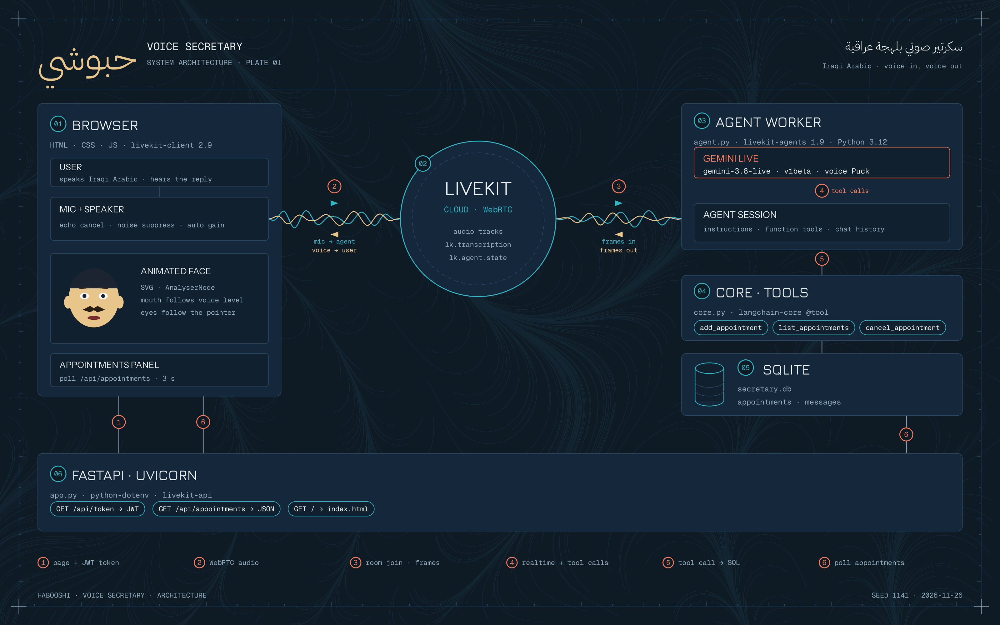

# Habooshi (حبوشي): a voice secretary that speaks Iraqi Arabic

Habooshi is a personal voice assistant that keeps track of your appointments. You talk to it in the browser, it answers out loud in Iraqi dialect, and it adds, lists and cancels appointments in a local SQLite database. The browser shows an animated face whose mouth follows the level of the voice.

**حبوشي** سكرتير صوتي شخصي يحجي باللهجة العراقية وينظّم مواعيدك. تحجي وياه من المتصفح، يرد عليك بصوت، ويسجّل المواعيد ويلغيها ويعرضها من قاعدة بيانات محلية.



## How it works

1. The browser asks the FastAPI server for a LiveKit token and joins a new room.
2. The agent worker (`agent.py`) joins the same room and opens a Gemini Live session.
3. Your microphone audio goes through LiveKit to Gemini, and the spoken reply comes back the same way.
4. When you ask for something like "book a doctor tomorrow at five", Gemini calls a tool (`add_appointment`, `list_appointments` or `cancel_appointment`) defined in `core.py`, which reads and writes SQLite.
5. The page polls `/api/appointments` every 3 seconds, so the side panel updates after each change.

## Tech stack

| Part | Choice |
|---|---|
| Voice and language model | Gemini Live (`gemini-3.8-live`, API version `v1beta`) |
| Realtime transport | LiveKit Cloud (WebRTC) and `livekit-agents` 1.9 |
| Tools | `langchain-core` `@tool` functions in `core.py` |
| Storage | SQLite (`appointments` and `messages` tables) |
| Backend | FastAPI and Uvicorn |
| Frontend | HTML, CSS, JavaScript, SVG face, `livekit-client` 2.9 |

## Requirements

- Python 3.12 (3.14 has no pip in some Windows installs and lacks wheels for several dependencies)
- A Google AI Studio API key
- A LiveKit Cloud project (the free tier is enough)
- Chrome or Edge, with microphone access

## Setup

**Windows (PowerShell)**

```powershell
git clone https://github.com/Ahm141/habooshi-voice-secretary.git
cd habooshi-voice-secretary
py -3.12 -m venv .venv
.venv\Scripts\Activate.ps1
python -m pip install -r requirements.txt
copy .env.example .env
```

**macOS / Linux**

```bash
git clone https://github.com/Ahm141/habooshi-voice-secretary.git
cd habooshi-voice-secretary
python3.12 -m venv .venv
source .venv/bin/activate
pip install -r requirements.txt
cp .env.example .env
```

Then open `.env` and fill in `GOOGLE_API_KEY`, `LIVEKIT_URL`, `LIVEKIT_API_KEY` and `LIVEKIT_API_SECRET`. Keep the file private. It is already listed in `.gitignore`.

If PowerShell refuses to activate the environment, run this once:

```powershell
Set-ExecutionPolicy -Scope CurrentUser RemoteSigned
```

## Run

Open two terminals in the project folder, and activate the virtual environment in each.

Terminal 1, the web server:

```bash
uvicorn app:app --reload
```

Terminal 2, the voice agent:

```bash
python agent.py dev
```

Open `http://127.0.0.1:8000/` in Chrome or Edge, press **ابدأ الحديث**, and allow the microphone. Use headphones for the first test, otherwise the agent can hear its own voice and interrupt itself.

Things to try:

- "سجّل لي موعد دكتور باجر الساعة خمسة"
- "شنو مواعيدي؟"
- "الغي موعد الدكتور"

After you change `.env` or `agent.py`, stop the agent with `Ctrl+C`, start it again, and press **انهاء** then **ابدأ الحديث** in the browser so a new room is created.

## Configuration

| Variable | Purpose | Default |
|---|---|---|
| `GEMINI_LIVE_MODEL` | Gemini Live model name | `gemini-3.8-live` |
| `GEMINI_VOICE` | Voice name (for example `Puck`, `Achird`, `Charon`, `Kore`) | `Puck` |

The assistant's name, dialect and rules live in `system_prompt()` inside `core.py`.

## Project structure

```
.
├── agent.py            LiveKit agent worker, Gemini Live session, tool wrappers
├── app.py              FastAPI: token endpoint, appointments API, serves the page
├── core.py             SQLite setup, appointment tools, system prompt
├── static/
│   └── index.html      Browser UI: animated face, mic control, appointments panel
├── docs/
│   └── architecture.png
├── requirements.txt
├── .env.example
└── .gitignore
```

## Troubleshooting

- **The status stays on "waiting for Habooshi":** the agent did not join the room. Read the agent terminal. An old agent process can also take the job, so stop every Python process and start again.
- **`server rejected WebSocket connection: HTTP 404`:** the Gemini Live model name is not available for your key. Google renames and retires preview models, so check the current Live model name in AI Studio and set `GEMINI_LIVE_MODEL`. Keep `google-genai` and `livekit-plugins-google` up to date, and keep `api_version="v1beta"` in `agent.py`.
- **`Could not import module "app"`:** you started `uvicorn` from the wrong folder. Run it from the folder that contains `app.py`.
- **The page shows "Forbidden" or invalid JSON:** the page was opened from another server, for example Live Server on port 5500. Open `http://127.0.0.1:8000/` instead.
- **The face looks broken after editing `index.html`:** press `Ctrl+F5`, then check the browser console (F12) for errors.

## Limitations

- The Gemini voices are general Arabic voices. The dialect comes from the prompt, so the pronunciation is not a true Iraqi accent.
- It is built for one user on one machine. The token endpoint has no login, so do not expose the server to the internet as it is.
- Conversation history is stored in plain text in `secretary.db`.

## Ideas for next steps

- Reminders before an appointment
- Telegram notifications
- Tests for the appointment tools and for dialect understanding
- Login for the token endpoint, so it can run on a server

## License

MIT. See `LICENSE`.
